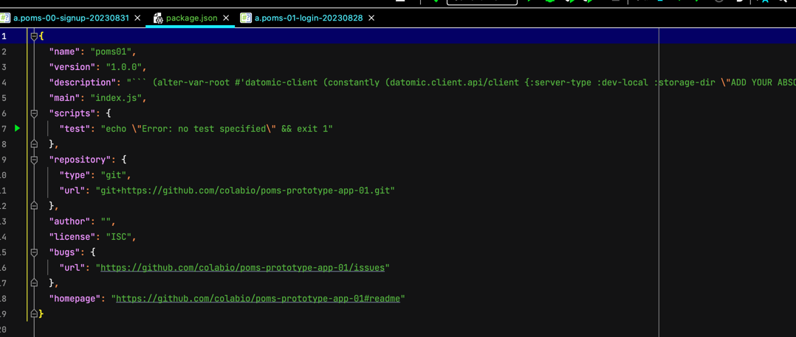
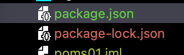

# electric-datomic-reagent-template

A ClojureScript starter that combines Hyperfiddle Electric, Datomic Local and Reagent/React in one app.

## What it is

A template project: a Hyperfiddle Electric (v2-alpha) app served by Jetty, with a Datomic `dev-local` database, Reagent and React components (Slate editor, data table, charts) rendered inside Electric, built by shadow-cljs. It includes two demo pages (signup and login) and the Electric todo-list demo.

## Why it exists

Per the commit history (October 2023) and `logs.md` (debug notes, in Turkish), it was built to learn how to connect Electric, Datomic and React/Reagent, and to document the setup steps (see the original setup notes below). `poms-prototype-app-02` uses the same stack and carries the same documentation files.

## Contents

| Path | What it is |
| --- | --- |
| `src/app/` | Demo namespaces: `poms_00_signup_20230831.cljc`, `poms_01_login_20230828.cljc`, `todo_list.cljc`, `demo_index.cljc`, Electric server entry points for Java 8/Jetty 9 and Java 11/Jetty 10 |
| `src/user.clj`, `src/user.cljs`, `src/user_main.cljc`, `src/prod.clj` | Dev and production entry points |
| `src-build/build.clj` | tools.build script (`:build` alias) |
| `resources/` | Static assets, compiled JS, and a small `poms-db` Datomic dev-local data folder |
| `deps.edn`, `shadow-cljs.edn` | Clojure deps and the shadow-cljs build (nREPL on port 9001) |
| `package.json`, `package-lock.json` | npm deps: React 18, Slate, react-data-table-component, recharts |
| `Dockerfile`, `fly.toml`, `.dockerignore` | Container and Fly.io deploy config (app name `electric-starter-app`) |
| `logs.md` | Debug log kept while connecting Datomic and Electric |
| `img.png`, `img_1.png`, `data_modeling.png`, `readme-electric-error-reporting-proof.png` | Images used in the notes |
| `out/`, `.shadow-cljs/`, `node_modules/`, `.idea/`, `*.iml`, `.nrepl-port` | Build output, caches and IDE files that were committed to the repo |

## How to run

Prerequisites: JDK, Clojure CLI, Node.js. Datomic `dev-local` needs a storage directory configured (see the "POMS Demo project CONFIG" section below; point `:storage-dir` at the `poms-db` folder on your machine).

```bash
npm install
clj -A:dev -X user/main      # starts shadow-cljs and the Electric server
# app at http://localhost:8080, shadow-cljs UI at http://localhost:9630
```

## Tech stack

Clojure 1.11, ClojureScript 1.11, Hyperfiddle Electric v2-alpha, Reagent 1.2, React 18, Slate, Datomic `dev-local`, shadow-cljs, Jetty, Docker, Fly.io.

## Status

Archived template. Last commit 2023-10-10.

## Related repos

`poms-prototype-app-02` (same stack and documentation files, many more pages).

---

## Original setup notes

# React-Reagent setup and config

Let's add npm/package.json file into project.

```
$ npm init
```

Set up your package.json and then package.json file going to be created


Add react-reagent dependencies

```
"dependencies": {
    "create-react-class": "^15.7.0",
    "process": "^0.11.10",
    "react": "^18.2.0",
    "react-dom": "^18.2.0",
    "slate": "^0.94.1",
    "slate-react": "^0.97.0"
  }
```

```
$ npm install
```

after npm install command runs you will see

package-lock.json file is created.

Let' add reagent dependency indo deps.end file.

```
reagent/reagent {:mvn/version "1.2.0"}
```

import required packages

```
#?(:cljs (:require-macros [app.poms-00-signup-20230831 :refer [with-reagent]]))
            #?(:cljs ["react" :as react])
            #?(:cljs ["slate" :refer [createEditor]])
            #?(:cljs ["slate-react" :refer [Slate Editable withReact]])
            #?(:cljs [reagent.core :as r])
            #?(:cljs [reagent.dom :as rdom])
            #?(:cljs ["react-dom/client" :as ReactDom])
            #?(:cljs ["react-data-table-component$default" :as DataTable])
```

add boilerplate code blocks in your namespace
```
#?(:cljs (defn create-root
"See https://reactjs.org/docs/react-dom-client.html#createroot"
([node] (create-root node (str (gensym))))
([node id-prefix]
(ReactDom/createRoot node #js {:identifierPrefix id-prefix}))))
#?(:cljs (defn render [root & args]
(.render root (r/as-element (into [:f>] args)))))
(defmacro with-reagent [& args]
`(dom/div
(let [root# (create-root dom/node)]
(render root# ~@args)
(e/on-unmount #(.unmount root#)))))
```


# POMS Demo project CONFIG
```
(alter-var-root #'datomic-client (constantly (datomic.client.api/client {:server-type :dev-local
:storage-dir "ADD YOUR ABSOLUTE DATABASE PATH HERE" 
;CONTENT/REPO DATABASE PATH: poms-db/ci/poms-db 
:system "ci"})))
```

# POMS Demo project

```
$ clj -A:dev -X user/main

Starting Electric compiler and server...
shadow-cljs - server version: 2.20.1 running at http://localhost:9630
shadow-cljs - nREPL server started on port 9001
[:app] Configuring build.
[:app] Compiling ...
[:app] Build completed. (224 files, 0 compiled, 0 warnings, 1.93s)

👉 App server available at http://0.0.0.0:8080
```